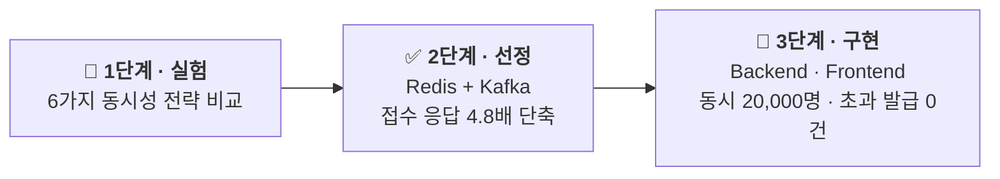
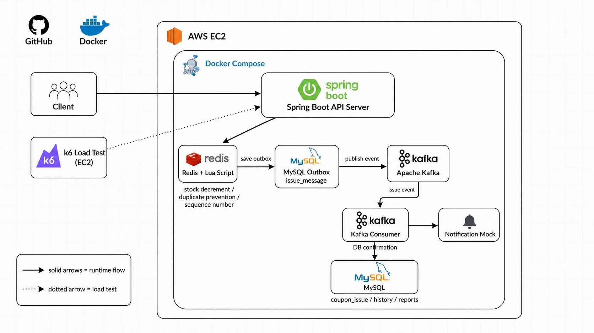
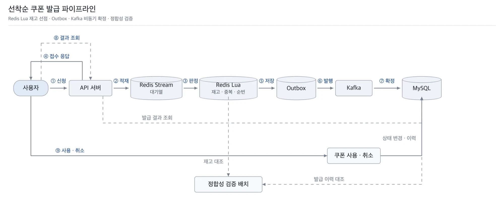
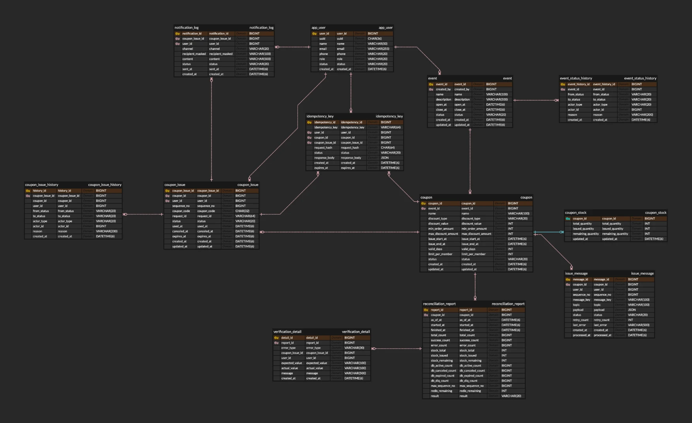

# 🐾 PetCoupon — 선착순 쿠폰 발급 시스템

> 대규모 동시 요청 상황에서도 **초과 발급 0건**과 **1인 1매**를 보장하는 선착순 쿠폰 발급 플랫폼입니다.

<p>
  
  
  
  
  
  
  
  
  
</p>

---

## 📌 프로젝트 소개

선착순 쿠폰 발급은 짧은 시간에 같은 재고로 요청이 몰립니다. 동시성 제어가 없으면 **초과 발급과 갱신 유실**이 생기고, 잠금으로 정합성을 지키더라도 높은 경합에서 **처리량과 응답 속도**가 충분한지는 따로 확인해야 합니다.

우리 팀은 이 문제를 감으로 결정하지 않고, **실험으로 전략을 고른 뒤 그 전략으로 실제 서비스를 구현**했습니다.



### 핵심 요구사항

| # | 요구사항 |
| --- | --- |
| 1 | 발급 수량이 쿠폰 전체 수량을 초과하지 않는다 |
| 2 | 동일한 사용자는 하나의 쿠폰을 중복 발급받을 수 없다 |
| 3 | 같은 요청이 재전송되더라도 한 번만 처리한다 |
| 4 | Kafka 메시지가 중복 전달되더라도 DB에는 한 번만 반영한다 |
| 5 | 일시적인 장애가 발생하더라도 발급 요청이 유실되지 않는다 |
| 6 | 자동 복구가 불가능한 메시지는 수동 재처리할 수 있다 |

**정합성이 성능보다 우선입니다.** 초과 발급이 1건이라도 발생하면 성능 수치와 무관하게 실패로 판정합니다.

---

## 📦 Repositories

| Repository | 역할 |
| --- | --- |
| [**coupon-concurrency-experiment**](https://github.com/PetCare-Platform/coupon-concurrency-experiment) | 6가지 동시성 제어 전략을 동일 조건에서 비교한 실험 모듈 |
| [**petcoupon-backend**](https://github.com/PetCare-Platform/petcoupon-backend) | 선정한 Redis + Kafka 구조로 구현한 쿠폰 발급 백엔드 |
| [**petcoupon-frontend**](https://github.com/PetCare-Platform/petcoupon-frontend) | 사용자 발급 화면, 관리자 이벤트·쿠폰 관리, 운영 대시보드 |

---

## 🔬 1단계 — 동시성 전략 실험

같은 쿠폰 발급 기능을 6개 전략으로 구현하고, AWS의 독립된 서버에서 k6로 동시 요청을 보내 비교했습니다. 응답 성능뿐 아니라 **초과 발급 · 1인 1매 · 중복 요청 · 최종 재고 정합성**을 함께 검증했습니다.

| 단계 | 비교 대상 | 재고 / 요청 |
| --- | --- | ---: |
| 실험 A | `DIRECT` `PESSIMISTIC` `OPTIMISTIC` `CONDITIONAL` `REDIS` | 10/20 → 1,000/2,000 |
| 실험 B | `REDIS` vs `KAFKA` | 10/20 → 1,000/2,000 |
| 최종 검증 | `KAFKA` | 10,000/20,000 |

### 재고 차감 전략 비교 (재고 1,000 · 요청 2,000 · 3회 평균)

| 전략 | 정합성 | 처리량 | p95 응답 시간 |
| --- | :---: | ---: | ---: |
| `DIRECT` (제어 없음) | ✕ | 138 req/s | 12,988ms |
| `PESSIMISTIC` | ○ | 227 req/s | 8,195ms |
| `OPTIMISTIC` | ○ | 215 req/s | 8,798ms |
| `CONDITIONAL` | ○ | 235 req/s | 8,005ms |
| `REDIS` (Lua Script) | ○ | **855 req/s** | **1,941ms** |

DB 기반 전략은 재고 한 행에 대한 경합으로 약 220 req/s 부근에서 포화했습니다. Redis Lua Script는 DB 최선인 `CONDITIONAL`보다 처리량이 **3.6배** 높았습니다.

### Redis 동기 저장 vs Kafka 비동기 저장

| 지표 | `REDIS` | `KAFKA` |
| --- | ---: | ---: |
| 평균 접수 응답 | 1,262.9ms | **262.8ms** (4.8배 ↓) |
| p95 접수 응답 | 1,795.2ms | **492.6ms** |
| DB 최종 반영 완료 | **2.28초** | 5.22초 |
| 정합성 | ○ | ○ |

### ✅ 최종 선정: Redis + Kafka

선착순 쿠폰에서는 최종 저장 완료 속도보다 **사용자가 체감하는 신청 접수 속도**가 더 중요하다고 판단했습니다. Redis로 재고를 원자적으로 선점하고, Kafka로 DB 저장을 비동기화해 무거운 DB 쓰기를 응답 경로에서 분리했습니다.

👉 상세: [실험 설계](https://github.com/PetCare-Platform/coupon-concurrency-experiment/blob/dev/docs/concurrency-experiment.md) · [실험 결과](https://github.com/PetCare-Platform/coupon-concurrency-experiment/blob/dev/docs/experiment-results.md)

---

## 🏗 2단계 — 시스템 아키텍처

### 기술 스택 · 인프라 구성

<p align="center">
  
</p>

### 선착순 쿠폰 발급 파이프라인

<p align="center">
  
</p>

쿠폰 발급은 요청을 **접수하는 단계**와 실제 발급을 **확정하는 단계**로 나뉩니다.

```text
POST /coupons/{couponId}/issues
  → Idempotency-Key 검증 → Redis Stream 적재 → 202 Accepted
  → Stream Consumer → Lua Script (재고 차감 + 순번 채번 + 중복 확인)
  → Outbox 저장 → Kafka 발행 → Kafka Consumer → MySQL 발급 확정
```

| 계층 | 장치 | 역할 |
| --- | --- | --- |
| Redis | Lua Script | 재고 확인·차감·순번 채번·중복 신청 확인을 하나의 원자 실행으로 처리 |
| API | `Idempotency-Key` | 같은 API 요청의 중복 처리 방지 |
| Messaging | Outbox Pattern | 메시지 유실 방지 |
| Messaging | Retry / DLQ | 장애 복구와 수동 재처리 |
| DB | Unique Constraint | 1인 1매 · 순번 중복 · Kafka 재전달 중복 저장 방지 |

Redis는 "누가 통과했는가"를 빠르게 정하고, MySQL Unique 제약이 최종 판정자가 됩니다. Redis와 MySQL은 서로 다른 시스템이라 한쪽만 성공하는 구간이 있기 때문에 **여러 겹으로 정합성을 방어**합니다.

### ERD

<p align="center">
  
</p>

---

## 📈 3단계 — 최종 검증

AWS EC2 3대 분리 구성(k6 부하 발생기 / Spring Boot 앱 / MySQL·Redis·Kafka)에서, 회원 100만 건과 발급 이력 300만 건을 적재한 상태로 측정했습니다.

| 구분 | 결과 |
| --- | --- |
| 통합 테스트 | 80개 시나리오 **전건 통과** |
| 부하 테스트 정합성 | 동시 20,000명 · 재고 10,000 × 5회차 **초과 발급 · 중복 발급 · 순번 충돌 0건** |
| 부하 테스트 성능 | 접수 성공률 100% · 처리량 **1,030 TPS** · 전건 확정 220초 |

<p align="center">
  
</p>

👉 상세: [백엔드 README](https://github.com/PetCare-Platform/petcoupon-backend) · [부하 테스트 결과](https://github.com/PetCare-Platform/petcoupon-backend/blob/main/load-test/docs/load-test-result.md)

---

## 🖥 서비스 화면

<p align="center">
  
</p>

- **사용자**: 진행 중 이벤트 조회, 실시간 재고 확인, 선착순 쿠폰 발급, 내 쿠폰 사용·취소
- **관리자**: 이벤트·쿠폰 생성·수정·상태 변경
- **내부 운영**: 발급 대시보드, 시스템 헬스체크, 실시간 WARN/ERROR 로그, DLQ 재처리, 정합성 검증

---

## 👥 Team

| GitHub | 역할 |
| --- | --- |
| [@Catverdose](https://github.com/Catverdose) | 이벤트·쿠폰 관리, 관리자 운영·모니터링 |
| [@rien00](https://github.com/rien00) | 선착순 신청 API, Idempotency, 결과 조회 |
| [@tnqlsqkr](https://github.com/tnqlsqkr) | Redis Stream·Lua 동시성 제어, 장애 복구 |
| [@mercy0704](https://github.com/mercy0704) | Kafka·Outbox 비동기 파이프라인, 재시도·DLQ |
| [@shin838](https://github.com/shin838) | 쿠폰 상태 전이, 정합성 검증 Batch, 대시보드 |
| [@seyeonham](https://github.com/seyeonham) | 부하 테스트, 대량 데이터, 테스트 환경 구성, 운영 대시보드 |
